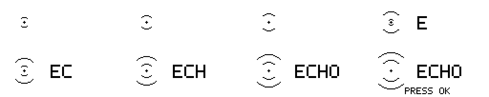

# Echo Firmware

**A personal Flipper Zero firmware with a consistent interface, a quieter visual identity, and tools organised around how you use them.**

[](https://github.com/P1tt1cus/Echo-Firmware/actions/workflows/build.yml)
[](https://github.com/P1tt1cus/Echo-Firmware/actions/workflows/lint.yml)

Echo is an independently maintained fork of [Momentum](https://github.com/Next-Flip/Momentum-Firmware), built on the Flipper Zero firmware ecosystem. It keeps that foundation and adds its own launcher, app dashboards, shared menus, desktop theme and installer.

**Current version: Echo 1.1 · Flipper Zero / f7 · API 87.1 · Maintained branch: `studio`**

## The Echo experience

Press the centre button from the desktop to open five destinations:

| Destination | Opens |
| --- | --- |
| **Radio** | Echo Radio, the separately installed ESP32 companion |
| **Remotes** | Infrared remotes and saved controls |
| **Sessions** | Echo Radio's saved captures and logs |
| **Tools** | The full app menu, including NFC, Sub-GHz, RFID and other installed tools |
| **Settings** | System settings |

Echo's native firmware works without an ESP32. Radio operations require the companion and compatible external hardware; browsing existing session files does not require a responding board.

### A consistent interface

- **App dashboards:** Remotes, NFC and Sub-GHz share four visible actions, descriptions, status and predictable navigation. Echo Radio uses the same design.
- **Shared menus:** apps using the standard Submenu and VariableItemList controls inherit Echo titles, selection counts, scrolling and contextual button hints.
- **Sub-GHz Replay Bench:** compare saved captures, inspect metadata and decoded-key differences, prepare one bounded replay, and record receiver observations separately from transmission status. See the [bench guide](documentation/echo/replay-bench.md).
- **Desktop identity:** an original monochrome pulse animation reveals the Echo wordmark.
- **Installer:** Echo branding, real progress, readable stages and retained error diagnostics, retry and exit controls.
- **Reliable native workflows:** clearer RFID/NFC results, cancellable BLE HID sequences, bounded RAW decoding, lower idle Sub-GHz memory use, IR hold/reorder controls and staged file saves. See the [validation record and physical-test limits](documentation/echo/workflow-polish.md).
- **Compatibility:** the maintained build retains API 87.1 and existing file formats. Internal application IDs and settings paths keep their established names so saved configuration continues to work.

Custom game screens, live views and file browsers keep their own rendering and controls. Echo does not replace every third-party interface.



### Controls

In Echo app dashboards, **Up/Down** selects an action, **Left/Right** jumps to the first or last action, **OK** opens it, and **Back** returns. Settings retain Left/Right for changing values. Live tools retain their app-specific controls.

## Build Echo

Clone this fork's maintained branch, including pinned dependencies:

```sh
git clone --branch studio --recurse-submodules https://github.com/P1tt1cus/Echo-Firmware.git
cd Echo-Firmware
FBT_NO_SYNC=1 ./fbt -j4 firmware_all updater_minpackage SKIP_EXTERNAL=1
```

The repository's fbt setup selects toolchain 39. The maintained source baseline is Momentum `d3f89dfe`, targeting **f7 / API 87.1**. See [studio-target.json](studio-target.json) for the compatibility record. Keep submodules at their checked-in revisions.

The firmware-only update is generated under:

```text
dist/f7-C/f7-update-echo-1.1-<commit>/
  update.fuf
  firmware.dfu
  updater.bin
```

This package updates the MCU firmware and updater; it does not replace the Bluetooth radio stack or SD-card resources/apps. Build the native dashboard apps, Echo's configuration app and Replay Bench separately:

```sh
FBT_NO_SYNC=1 ./fbt -j4 fap_infrared fap_nfc fap_subghz fap_momentum_app fap_echo_replay SKIP_EXTERNAL=1
```

Their FAPs are written to `build/f7-firmware-C/.extapps/`. Successful [Echo firmware CI runs](https://github.com/P1tt1cus/Echo-Firmware/actions/workflows/build.yml) also provide an `echo-f7-api87.1` artifact containing the update and these five apps. CI artifacts are development builds, not a separate stable release channel.

## Install

Use an **Echo build from this fork**. Momentum's web updater distributes upstream firmware and does not install Echo.

1. Copy the generated update directory to `SD/update/` using qFlipper's file manager.
2. On the Flipper, open the archive/file browser, navigate into that directory and run `update.fuf` (shown as **Update**).
3. Confirm **Install Echo** and let the update finish through its restart stages.
4. Install the matching app FAPs and Echo asset pack separately using the [build and installation guide](documentation/echo/README.md#build-and-install).

The guide covers exact app destinations, theme generation, device naming and validation. Existing devices retain their configured name until it is changed; installing Echo does not silently rename someone else's device. The Echo desktop theme is selected as an asset pack.

The Radio and Sessions shortcuts expect [Echo Radio](https://github.com/P1tt1cus/flipperzero-wifi-marauder), installed at `/ext/apps/GPIO/marauder_studio.fap`. It is maintained separately. [The ZY-ESP32 firmware fork](https://github.com/P1tt1cus/ESP32Marauder) is only needed for that external board.

## Validation and development

Run the host checks from the repository root. The asset validator needs Pillow, heatshrink2 and colorlog; the host GUI checks need a C compiler with sanitizer support.

```sh
python3 scripts/echo_menu_test.py
python3 scripts/echo_dashboard_test.py
python3 scripts/echo_shared_menu_test.py
python3 scripts/echo_replay_test.py
python3 scripts/echo_replay_control_test.py
python3 scripts/echo_installer_test.py --package-check
python3 scripts/echo_validate.py
```

Run the package check after building the updater. CI runs these checks alongside the pinned firmware/app builds. Build and host-test success are recorded separately from actual on-device verification.

Start changes from `studio` and target pull requests here. Review upstream updates on a separate integration branch; preserve Echo changes and dependency pins. Read [AGENTS.md](AGENTS.md) and the [Echo implementation guide](documentation/echo/README.md) before maintenance.

The proposed Echo BLE Lab, identity-testing workflows and Vox integration are **not implemented features**. Existing upstream Bluetooth tools remain available according to the installed app set.

## Issues and support

Report Echo-specific bugs and suggestions in [this repository's issues](https://github.com/P1tt1cus/Echo-Firmware/issues). Include the Echo version, source commit, app involved and steps to reproduce. Distinguish built-in Flipper behaviour from companion or external-board behaviour.

This is a personal fork, not an official Flipper Devices or Momentum release. It has no separate hosted web installer or upstream support commitment.

## Credits and licence

Echo builds on [Momentum](https://github.com/Next-Flip/Momentum-Firmware), [Flipper Devices firmware](https://github.com/flipperdevices/flipperzero-firmware), and the work of the [Unleashed](https://github.com/DarkFlippers/unleashed-firmware), Xtreme and third-party app communities. Their original copyright notices, source attribution and component licences remain in place.

The firmware is distributed under [GNU GPL v3](LICENSE), with individual dependencies and assets retaining their respective licences. The [archived Momentum README](documentation/UPSTREAM_README.md) preserves upstream project history and support links.

This fork permits owner-requested AI-assisted maintenance under [its own instructions](AGENTS.md). The [original upstream contribution policy](documentation/UPSTREAM_AGENT_POLICY.md) is retained as a reference; this fork's AI-assisted changes are not submitted upstream under that policy.
